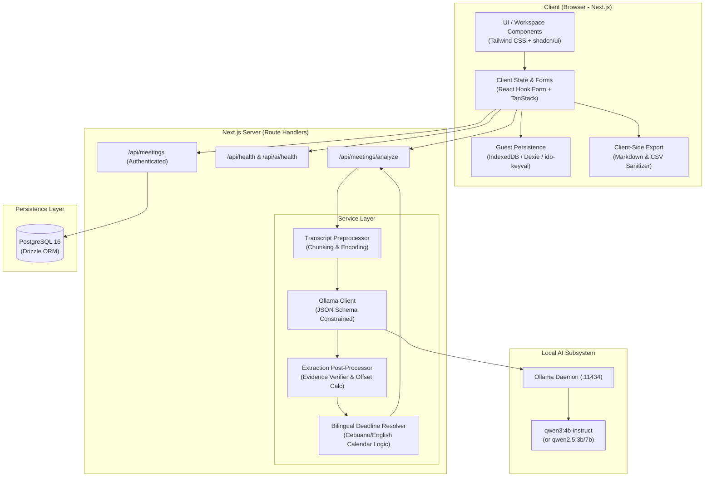

# Spec 04: System Architecture

## 1. High-Level Architecture Overview

Tambayayong is designed as a privacy-first, local-AI-powered web application using a modern full-stack architecture with Next.js App Router, local Ollama model hosting, PostgreSQL with Drizzle ORM, and local IndexedDB for guest mode.

---

## 2. Component Subsystems

### 2.1 Client Subsystem
- **Framework:** Next.js 14/15 App Router with React 18/19.
- **Styling & Components:** Tailwind CSS with custom theme tokens (`#247D59` primary green, warm neutrals `#F8FAF8`), Radix UI primitives / shadcn/ui, Lucide icons.
- **State Management:** URL state, React Hook Form with Zod validation, local IndexedDB layer for offline/guest auto-save.
- **Bilingual UI:** Clean interface with bilingual notes guidance (English & Cebuano hints).

### 2.2 Server Service Layer
Separation of concerns is maintained inside `src/server/services/`:
1. **`transcript-preprocessor.ts`:** Sanitizes text, normalizes line breaks, counts tokens, segments oversized transcripts with semantic windowing when exceeding context limit.
2. **`ollama-client.ts`:** Interfaces with `http://localhost:11434` (or configured `OLLAMA_HOST`), checks model availability, triggers chat completions with JSON schema structured output.
3. **`evidence-verifier.ts`:** Scans source notes for verbatim and normalized matches of extracted quotes; computes character offsets (`startOffset`, `endOffset`); flags ungrounded items.
4. **`deadline-resolver.ts`:** Parses Cebuano phrases (*ugma*, *karong biyernes*, *sunod semana*, *sa lunes*) and English phrases (*tomorrow*, *next week*, *by Friday*, *before Oct 20*); resolves absolute ISO dates anchored to the meeting date.
5. **`export-service.ts`:** Formats clean Markdown checklists and CSV exports with spreadsheet injection protection.

### 2.3 Local AI Runtime (Ollama)
- **Model:** `qwen3:4b-instruct` (or `qwen2.5:3b` / `qwen2.5:7b-instruct` / user-configured via `OLLAMA_MODEL`).
- **Structured Output:** Strictly enforced using Ollama's `format` parameter with a JSON Schema derived from Zod.
- **Privacy Guarantee:** 100% self-hosted. Zero telemetry, zero external token forwarding.

### 2.4 Database Subsystem (PostgreSQL + Drizzle ORM)
- Complete relational schema supporting organizations, meetings, tasks, assignees, decisions, open questions, and audit runs.
- Runs locally in Docker or attached to managed Postgres.
- Guest mode operates entirely in browser IndexedDB so zero setup is required for instant trials.
