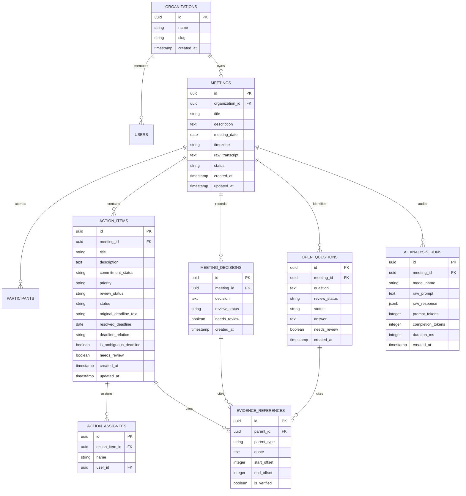

# Spec 05: Database Schema & Relational Design

## 1. Overview
The database layer supports multi-tenant organizations, meetings, structured extractions, and human revision auditing using PostgreSQL and Drizzle ORM.

For guest sessions, the client mirror of this schema runs in browser-local IndexedDB.



---

## 2. Table Definitions (Drizzle ORM Schema)

```typescript
import { pgTable, uuid, text, timestamp, boolean, integer, date, jsonb, pgEnum } from "drizzle-orm/pg-core";

export const reviewStatusEnum = pgEnum("review_status", ["pending", "approved", "rejected"]);
export const taskStatusEnum = pgEnum("task_status", ["todo", "in_progress", "blocked", "completed"]);
export const questionStatusEnum = pgEnum("question_status", ["open", "answered"]);
export const commitmentStatusEnum = pgEnum("commitment_status", ["confirmed", "proposed", "unclear"]);
export const priorityEnum = pgEnum("priority", ["low", "medium", "high"]);
export const deadlineRelationEnum = pgEnum("deadline_relation", ["before", "by", "on", "after"]);

export const organizations = pgTable("organizations", {
  id: uuid("id").primaryKey().defaultRandom(),
  name: text("name").notNull(),
  slug: text("slug").unique().notNull(),
  createdAt: timestamp("created_at").defaultNow().notNull(),
  updatedAt: timestamp("updated_at").defaultNow().notNull(),
});

export const meetings = pgTable("meetings", {
  id: uuid("id").primaryKey().defaultRandom(),
  organizationId: uuid("organization_id").references(() => organizations.id, { onDelete: "cascade" }),
  title: text("title").notNull(),
  description: text("description"),
  meetingDate: date("meeting_date"),
  timezone: text("timezone").default("Asia/Manila").notNull(),
  rawTranscript: text("raw_transcript").notNull(),
  summary: text("summary"),
  nextMeetingDate: date("next_meeting_date"),
  nextMeetingText: text("next_meeting_text"),
  createdAt: timestamp("created_at").defaultNow().notNull(),
  updatedAt: timestamp("updated_at").defaultNow().notNull(),
});

export const actionItems = pgTable("action_items", {
  id: uuid("id").primaryKey().defaultRandom(),
  meetingId: uuid("meeting_id").references(() => meetings.id, { onDelete: "cascade" }).notNull(),
  title: text("title").notNull(),
  description: text("description"),
  commitmentStatus: commitmentStatusEnum("commitment_status").default("confirmed").notNull(),
  priority: priorityEnum("priority"),
  reviewStatus: reviewStatusEnum("review_status").default("pending").notNull(),
  status: taskStatusEnum("status").default("todo").notNull(),
  originalDeadlineText: text("original_deadline_text"),
  resolvedDeadline: date("resolved_deadline"),
  deadlineTime: text("deadline_time"),
  deadlineRelation: deadlineRelationEnum("deadline_relation"),
  isAmbiguousDeadline: boolean("is_ambiguous_deadline").default(false).notNull(),
  missingInformation: jsonb("missing_information").$type<string[]>().default([]).notNull(),
  needsReview: boolean("needs_review").default(false).notNull(),
  createdAt: timestamp("created_at").defaultNow().notNull(),
  updatedAt: timestamp("updated_at").defaultNow().notNull(),
});

export const actionAssignees = pgTable("action_assignees", {
  id: uuid("id").primaryKey().defaultRandom(),
  actionItemId: uuid("action_item_id").references(() => actionItems.id, { onDelete: "cascade" }).notNull(),
  name: text("name").notNull(),
  createdAt: timestamp("created_at").defaultNow().notNull(),
});

export const meetingDecisions = pgTable("meeting_decisions", {
  id: uuid("id").primaryKey().defaultRandom(),
  meetingId: uuid("meeting_id").references(() => meetings.id, { onDelete: "cascade" }).notNull(),
  decision: text("decision").notNull(),
  reviewStatus: reviewStatusEnum("review_status").default("pending").notNull(),
  needsReview: boolean("needs_review").default(false).notNull(),
  createdAt: timestamp("created_at").defaultNow().notNull(),
});

export const openQuestions = pgTable("open_questions", {
  id: uuid("id").primaryKey().defaultRandom(),
  meetingId: uuid("meeting_id").references(() => meetings.id, { onDelete: "cascade" }).notNull(),
  question: text("question").notNull(),
  reviewStatus: reviewStatusEnum("review_status").default("pending").notNull(),
  status: questionStatusEnum("status").default("open").notNull(),
  answer: text("answer"),
  needsReview: boolean("needs_review").default(false).notNull(),
  createdAt: timestamp("created_at").defaultNow().notNull(),
});

export const evidenceReferences = pgTable("evidence_references", {
  id: uuid("id").primaryKey().defaultRandom(),
  parentId: uuid("parent_id").notNull(),
  parentType: text("parent_type").notNull(), // 'action_item' | 'decision' | 'open_question'
  quote: text("quote").notNull(),
  startOffset: integer("start_offset"),
  endOffset: integer("end_offset"),
  isVerified: boolean("is_verified").default(false).notNull(),
  createdAt: timestamp("created_at").defaultNow().notNull(),
});

export const aiAnalysisRuns = pgTable("ai_analysis_runs", {
  id: uuid("id").primaryKey().defaultRandom(),
  meetingId: uuid("meeting_id").references(() => meetings.id, { onDelete: "cascade" }).notNull(),
  modelName: text("model_name").notNull(),
  prompt: text("prompt").notNull(),
  rawResponse: jsonb("raw_response").notNull(),
  durationMs: integer("duration_ms").notNull(),
  createdAt: timestamp("created_at").defaultNow().notNull(),
});
```
