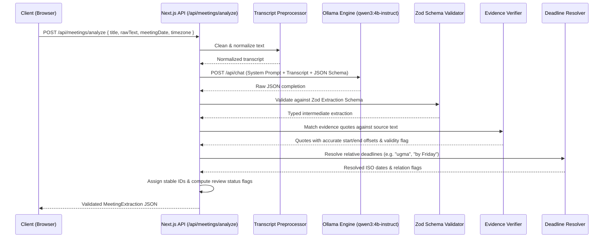

# Spec 06: AI Extraction Pipeline & Bilingual Prompting

## 1. Pipeline Overview
The extraction pipeline transforms raw meeting notes (English, Cebuano, or mixed) into validated, schema-compliant action items, decisions, and questions.



---

## 2. Bilingual Prompting Architecture

### 2.1 System Prompt
```text
You are Tambayayong, an expert bilingual meeting-intelligence assistant specializing in English, Cebuano (Bisaya), and English-Cebuano code-switching.

Analyze the provided meeting notes and extract structured commitments, decisions, and open questions.

STRICT EXTRACTION RULES:
1. NEVER INVENT OWNERS: If no one volunteered or was assigned, return an empty assignees list. Do not guess names.
2. NEVER INVENT DEADLINES: If no deadline was mentioned, set deadline to null.
3. DETECT NEGATIONS & CANCELLATIONS: If an idea or proposal was cancelled or rejected (e.g., "dili na ta mag-order ug shirts", "cancel na to ang physical venue"), DO NOT create an action item. You may record it as a decision if agreed.
4. HANDLE CHANGES & CORRECTIONS: If an assignment or deadline is corrected later in the conversation (e.g., "Si Ana sa poster. Ay, si Mark na lang diay"), the later correction supersedes earlier statements.
5. DISTINGUISH SUGGESTIONS FROM COMMITMENTS:
   - "Maybe si Carlo ang magdesign" -> commitmentStatus = "proposed", needsReview = true.
   - "Carlo will design the poster" / "Ako na bahala sa poster - Carlo" -> commitmentStatus = "confirmed".
6. VERBATIM EVIDENCE: For EVERY action item, decision, and open question, you MUST provide an exact, verbatim supporting quotation from the original notes.
7. LANGUAGE AWARENESS:
   - Understand Cebuano time markers: "ugma" (tomorrow), "sunod semana" (next week), "karong biyernes" (this Friday), "sa lunes" (on Monday), "karong hapon" (this afternoon).
   - Understand Cebuano agreement/negation: "dili" (not/don't), "ayaw" (don't), "okay na" (settled), "diay" (actually/turns out), "wala pa" (none yet).
8. UNRESOLVED QUESTIONS: Extract explicit unanswered questions or pending decisions.

Return ONLY a JSON object strictly conforming to the requested schema.
```

---

## 3. Structured Output JSON Schema

```typescript
import { z } from "zod";

export const RawExtractionSchema = z.object({
  summary: z.string().describe("A concise factual summary of the meeting grounded in the source text"),
  actionItems: z.array(z.object({
    title: z.string().describe("Concise imperative action title"),
    description: z.string().nullable().describe("Additional context or details"),
    assignees: z.array(z.string()).describe("List of exact participant names assigned to the task"),
    originalDeadlineText: z.string().nullable().describe("The verbatim deadline phrase used in notes, e.g., 'ugma sa hapon', 'by Friday'"),
    deadlineRelation: z.enum(["before", "by", "on", "after"]).nullable().describe("Temporal relation"),
    commitmentStatus: z.enum(["confirmed", "proposed", "unclear"]).describe("Whether task was firmly agreed, proposed, or ambiguous"),
    priority: z.enum(["low", "medium", "high"]).nullable().describe("Explicit priority if stated"),
    evidenceQuote: z.string().describe("Exact verbatim substring from the source notes justifying this task"),
    missingInformation: z.array(z.string()).describe("List of missing fields like 'assignee' or 'deadline'"),
  })),
  decisions: z.array(z.object({
    decision: z.string().describe("A statement of what was explicitly agreed upon"),
    evidenceQuote: z.string().describe("Exact verbatim substring from the source notes"),
  })),
  openQuestions: z.array(z.object({
    question: z.string().describe("An unanswered question or item requiring clarification"),
    evidenceQuote: z.string().describe("Exact verbatim substring from the source notes"),
  })),
  nextMeetingText: z.string().nullable().describe("Explicit next meeting statement if mentioned, else null"),
});
```

---

## 4. Evidence Verification & Offset Matching
The backend executes a multi-tier substring locator:
1. **Tier 1 (Exact Match):** Finds exact index of `evidenceQuote` in `rawText`. If found:
   `startOffset = rawText.indexOf(evidenceQuote)`
   `endOffset = startOffset + evidenceQuote.length`
   `isVerified = true`
2. **Tier 2 (Normalized Whitespace Match):** Normalizes multiple spaces, tabs, and newlines in both `rawText` and `evidenceQuote` while tracking character index mapping.
3. **Tier 3 (Fuzzy Fallback):** If match is still not found, `isVerified = false`, `startOffset = null`, `endOffset = null`, and `needsReview = true` is set. The UI highlights this item as unverified for human review.

---

## 5. Relative Deadline Resolution
Given `meetingDate` (e.g. `2026-10-23`) and `timezone` (`Asia/Manila`):
- `ugma` / `tomorrow` -> `meetingDate + 1 day`
- `sa sunod adlaw` / `day after tomorrow` -> `meetingDate + 2 days`
- `karong biyernes` / `this Friday` -> closest upcoming Friday
- `sunod semana` / `next week` -> `meetingDate + 7 days` (marked `isAmbiguous = true` if specific day omitted)
- `before Oct 28` / `sa dili pa mag Oct 28` -> date: `2026-10-28`, relation: `before`
- If `meetingDate` is unknown: absolute date is set to `null`, `isAmbiguous = true`, preserving the original phrase.
